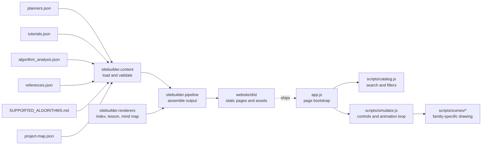

# Website architecture

The site is a data-driven static application. GitHub Pages serves generated files from `website/dist`; the build uses only the Python standard library and runs in the existing Pages workflow.

## Responsibilities

- `data/` holds planner descriptions, lessons, algorithm analyses, research references, and the project map. These files are the site content source.
- `sitebuilder/content.py` loads the content once, checks it against `SUPPORTED_ALGORITHMS.md`, and validates lesson, analysis, reference, source-path, and cross-reference coverage.
- `sitebuilder/math_text.py` handles safe HTML escaping and inline LaTeX conversion.
- `sitebuilder/renderers/` owns static markup for the catalog, algorithm lessons, and project map. Each generated lesson remains directly indexable without JavaScript and includes its source-paper citation.
- `sitebuilder/pipeline.py` owns output safety, static asset copying, generated family filters, lesson routes, and the sitemap. It writes generated files only to the selected output directory.
- `app.js` starts the browser application. `scripts/catalog.js` owns catalog interactions, while `scripts/simulator.js` owns simulator state and controls. Canvas drawing is split into the grid, continuous, temporal, and multi-agent scene modules.
- `build_site.py` stays as the stable command-line entry point used by GitHub Actions and local builds.

## Adding a planner

For a planner in an existing family, add its implementation and supported-matrix row, then add matching entries to `data/planners.json`, `data/tutorials.json`, `data/algorithm_analysis.json`, and `data/references.json`. Each reference records its authors, title, year, venue or source, link, and reference type. Label early or foundational references when a single original paper is not established, and add a note when the repository implementation differs from the cited method. The builder derives page count, lesson numbering, sitemap routes, catalog cards, and family-filter counts from those records. It rejects missing or extra IDs before generating output.

Adding a new problem family also requires one family label and summary in `sitebuilder/config.py`, plus its simulator labels and scene renderer. The content contract stays unchanged: one planner record, one tutorial, one analysis, and one supported-matrix entry per planner.

## Build and deployment

Run `python3 website/build_site.py` to create `website/dist`. The command refuses to clear an output directory unless it contains the builder ownership marker. The Pages workflow uploads only `website/dist`; generated output is ignored by Git. The sitemap is generated into that output and the build does not rewrite source files.
