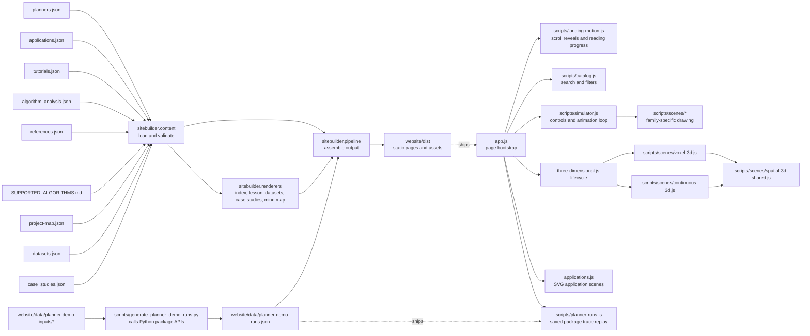

# Website architecture

The site is a data-driven static application. GitHub Pages serves generated files from `website/dist`; the build uses only the Python standard library and runs in the existing Pages workflow.

## Responsibilities

- The dataset guide and source-specific profiles are generated from website/data/datasets.json. The builder validates their sections, citations, repository paths, and related-profile links before writing indexable pages and sitemap entries.
- Benchmark case studies are written once in `data/case_studies.json`. Content validation checks the dataset cross-references, evidence summaries, source URLs, and supported diagram types; the renderer uses the same records for home-page cards and the indexable `/case-studies/` route.
- `data/` holds planner descriptions, lessons, algorithm analyses, research references, application examples, datasets, case studies, and the project map. The six home-page application cards select named SVG scenes from `sitebuilder/renderers/application_visuals.py`; `scripts/applications.js` follows each scene's own SVG geometry, pauses off-screen, and honors reduced-motion preferences. Application examples are shared across the home page and family-specific lesson pages; project-evidence notes keep model analogies distinct from measured coverage.
- `sitebuilder/content.py` loads the content once, checks it against `SUPPORTED_ALGORITHMS.md`, and validates lesson, analysis, reference, application, source-path, and cross-reference coverage.
- `sitebuilder/math_text.py` handles safe HTML escaping and inline LaTeX conversion.
- `sitebuilder/renderers/` owns static markup for the catalog, algorithm lessons, dataset profiles, case studies, and project map. Generated learning pages remain directly indexable without JavaScript and include their source references.
- `data/applications.json` is the shared application catalog. The home page introduces domains across the project, while each generated algorithm lesson selects application contexts for its planner family.
- `sitebuilder/pipeline.py` owns output safety, static asset copying, generated family filters, lesson and case-study routes, and the sitemap. It writes generated files only to the selected output directory.
- `app.js` starts the browser application. `scripts/catalog.js` owns catalog interactions. `scripts/simulator.js` renders explicitly labeled concept animations; those animations do not execute the selected planner. Canvas drawing is split into the grid, continuous, temporal, and multi-agent scene modules.
- `scripts/generate_planner_demo_runs.py` calls the public A* and continuous-planning APIs and the persistent D* Lite planner, captures native traces, validates final paths independently, and writes `data/planner-demo-runs.json`. Its input fixtures record source hashes and query details. `scripts/planner-runs.js` replays those saved native events; it never runs a planner in the browser. A*, D* Lite obstacle repair, and RRT* are the only package executions presented on the home page.
- `scripts/landing-motion.js` owns front-page scroll reveals and the reading-progress indicator. It uses `IntersectionObserver`, leaves content visible when scripting or motion support is unavailable, and honors reduced-motion preferences.
- `scripts/three-dimensional.js` owns the front-page 3D animation lifecycle. `scripts/scenes/voxel-3d.js` draws the voxel search, `continuous-3d.js` draws the sampling tree, and `spatial-3d-shared.js` contains their projection and drawing helpers. The lifecycle pauses off-screen and renders a complete static frame when reduced motion is requested; `three-dimensional.css` supplies the responsive card layout.
- `build_site.py` stays as the stable command-line entry point used by GitHub Actions and local builds.

## Adding a planner

For a planner in an existing family, add its implementation and supported-matrix row, then add matching entries to `data/planners.json`, `data/tutorials.json`, `data/algorithm_analysis.json`, and `data/references.json`. Each reference records its authors, title, year, venue or source, link, and reference type. Label early or foundational references when a single original paper is not established, and add a note when the repository implementation differs from the cited method. The builder derives page count, lesson numbering, sitemap routes, catalog cards, and family-filter counts from those records. It rejects missing or extra IDs before generating output.

Adding a new problem family also requires one family label and summary in `sitebuilder/config.py`, a family entry in `data/applications.json`, plus its simulator labels and scene renderer. The content contract stays unchanged: one planner record, one tutorial, one analysis, and one supported-matrix entry per planner.

## Build and deployment

Run `python3 website/build_site.py` to create `website/dist`. The command refuses to clear an output directory unless it contains the builder ownership marker. The Pages workflow uploads only `website/dist`; generated output is ignored by Git. The sitemap is generated into that output and the build does not rewrite source files.
